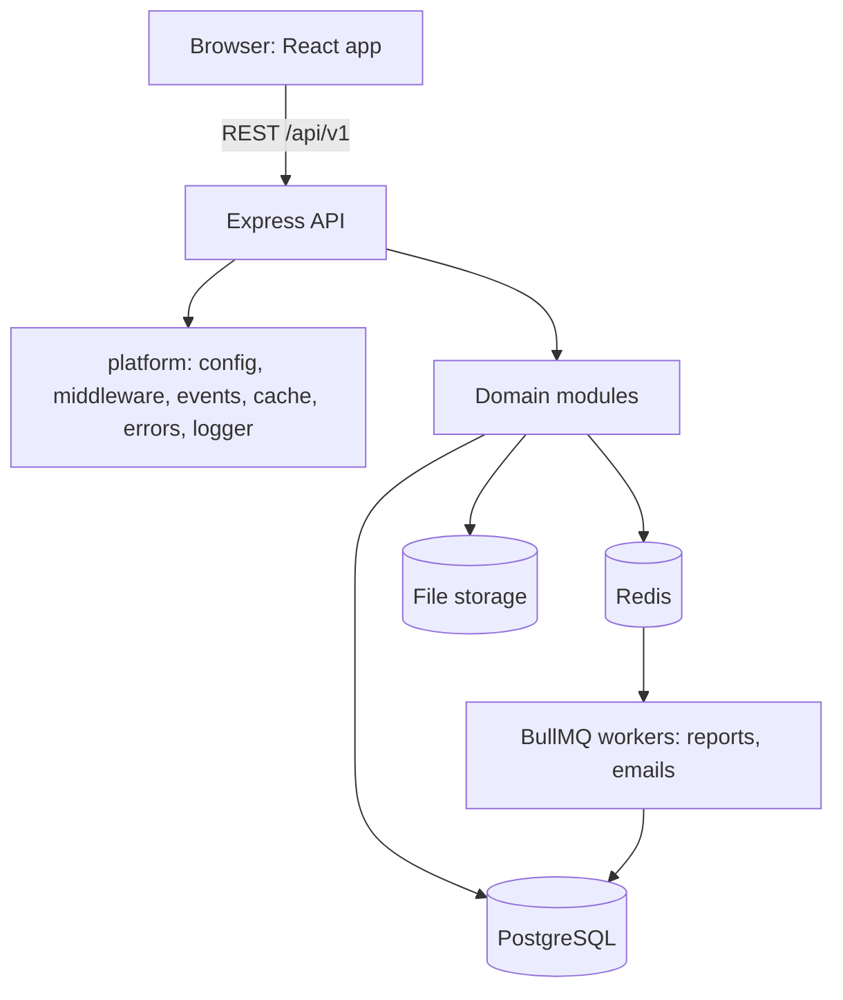
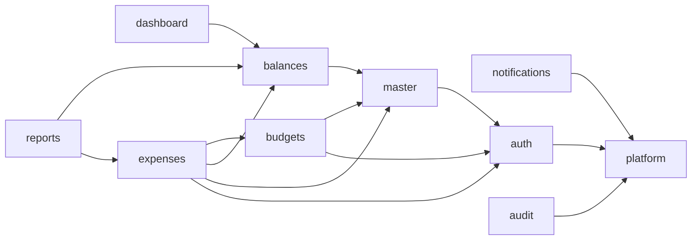

# ARCHITECTURE.md: Department Budget Spending Tracker

Instructions for AI coding agents and developers. Read together with `techstack.md` (stack, rules, API conventions) and `design.md` (frontend look). If this file conflicts with `techstack.md` on stack or hard rules, `techstack.md` wins. This file decides **how the system is split, and in what order it is built and grown.**

---

## 1. Principles

1. **Small first, grow by iteration.** Build the smallest working slice, test it, tag it, then extend it. Never build a later version's features early.
2. **Modular by contract.** Every module has one public entry (`index.js`) that exposes a small set of service functions. Other modules call only that, never its tables, files or internals.
3. **One-way dependencies.** A module may depend only on modules in lower layers (section 3). No cycles.
4. **Every iteration ships a working, tested system.** The app runs end to end after each iteration, with seed data.
5. **Extend, do not rewrite.** New versions plug into extension points (section 7). Migrations are additive. Existing tests keep passing.
6. **Tests are the gate.** A module version is "done" only when its gate in section 9 passes, including all earlier tests (regression).

---

## 2. System at a glance



Runtime pieces: `web` (React), `api` (Express), `worker` (BullMQ, introduced in Release 4), `postgres`, `redis`. All run via Docker Compose.

---

## 3. Layers and module catalog

Lower layers never import from higher layers.

| Layer | Modules | Role |
| --- | --- | --- |
| L0 Platform | `platform` | Config, auth/role/department middleware, validation, error format, logger, event bus, cache wrapper, audit writer interface, money and date utils |
| L1 Identity and reference | `auth` (users, login), `master` (financial years, departments, categories, vendors, settings), `audit` | Who is acting; what lists exist; permanent record |
| L2 Core domain | `budgets`, `expenses`, `balances` | Budget decisions, spending, calculation of figures |
| L3 Read and output | `dashboard`, `reports` | Read-only views over `balances` |
| L4 Reaction | `notifications` | Reacts to domain events |

Dependency graph (arrow = "may call"):



Rules that follow from the graph:
- `balances` is the **only** module that calculates Allocated, Committed, Spent, Available, Utilisation. It may read the `budget_items` and `expenses` tables **read-only** (SQL aggregation); it never writes them.
- `dashboard` and `reports` never write business data and never compute their own totals.
- `notifications` never changes business data; it only reacts to events.
- `audit.log()` is called by services **inside the same transaction** as the change (techstack rule 11). Audit is not driven by events.

---

## 4. Module template

Every backend module has this shape. Create it even when a part is empty at first.

```text
modules/<name>/
  index.js         PUBLIC API: the only file other modules may import
  routes.js        paths + middleware chain (auth -> role -> department -> validate)
  controller.js    HTTP only: read req, call service, shape response
  service.js       business rules, transactions, calls to other modules' index.js
  repository.js    Prisma queries for this module's own tables
  schema.js        Zod schemas for every request
  events.js        events this module emits (names + payload shape)
  README.md        contract: responsibilities, public API, events, version history
  __tests__/       unit (service), api (Supertest), contract tests
```

Rules:
- `controller` never holds business rules. `service` never touches `req` or `res`.
- Only `repository.js` talks to Prisma for the module's own tables.
- Cross-module access goes through `index.js` exports. Importing another module's `service.js` or `repository.js` is a defect.
- Each module's `README.md` has a **Version history** table. Update it every iteration.

Frontend mirrors this: `frontend/src/features/<name>/` with `pages/`, `components/`, `hooks/`, `api.js`, `routes.js`, and `index.js` exporting the feature's routes. Each feature is code-split (lazy loaded) and styled per `design.md`.

---

## 5. Module contracts

For each module: what it owns, what it exposes, what it emits, and how it grows. "vN" are versions delivered in the iterations of section 8.

### 5.1 `platform` (L0)

Exposes: `requireAuth`, `requireRole(...roles)`, `scopeDepartment`, `validate(schema)`, `AppError`, `errorHandler`, `logger`, `events` (`emit`, `on`), `cache` (`get`, `set`, `del`, `wrap`), `money` helpers, `dates` helpers, `featureEnabled(flag)`.

| Version | Content |
| --- | --- |
| v1 | All of the above. `cache` uses an in-memory no-op fallback; `events` uses Node `EventEmitter` (in-process, fired **after** commit) |
| v2 | `cache` backed by Redis (`ioredis`) with automatic fallback to no-op if Redis is down; rate-limit middleware |
| v3 | `events` can enqueue to BullMQ for slow subscribers (emails, reports) |

### 5.2 `auth` (L1)

Owns: `users`. Exposes: `getUserById(id)`, `getUserScope(user)`, `isActive(userId)`, `listApprovers(deptId, role)`.
Emits: `user.created`, `user.disabled`.

| Version | Content |
| --- | --- |
| v1 | Login, JWT access + refresh (httpOnly cookie), change password, create/disable users, six roles, department scoping |
| v2 | Redis refresh-token store, logout revocation list, login rate limit, forgot-password |

### 5.3 `master` (L1)

Owns: `financial_years`, `departments`, `categories`, `vendors`, `settings`, `approval_limits`.
Exposes: `getActiveFinancialYear()`, `assertYearOpen(fyId)`, `getDepartment(id)`, `listDepartments()`, `getCategory(id)`, `getSetting(key)`, `getApprovalLimit(role)`.
Emits: `year.closed`.

| Version | Content |
| --- | --- |
| v1 | Financial year (one active), departments (with sub-units via `parent_id`), categories; admin CRUD with soft delete |
| v2 | Vendors, settings (thresholds, over-budget policy), approval limits; Redis cache of master lists |
| v3 | Year close and lock (read-only after close), opening-data CSV import |

### 5.4 `audit` (L1)

Owns: `audit_logs` (insert-only). Exposes: `log(tx, { userId, action, table, recordId, oldValue, newValue })`, `search(filters)`.

| Version | Content |
| --- | --- |
| v1 | `log()` writer used by every service from the first write onward; `GET /audit-logs` for SUPER_ADMIN |
| v2 | Auditor role access, filters (user, table, date), export |

### 5.5 `budgets` (L2)

Owns: `budgets`, `budget_items`, `budget_revisions`. Exposes: `getApprovedBudget(fyId, deptId)`, `getBudgetItem(fyId, deptId, categoryId)`, `assertBudgetUsable(fyId, deptId)`.
Emits: `budget.submitted`, `budget.approved`, `budget.rejected`, `budget.revised`.

| Version | Content |
| --- | --- |
| v1 | Create budget with category items (sum must equal total), single approval by MANAGEMENT, freeze on approval. Statuses: `DRAFT`, `APPROVED`, `LOCKED` |
| v2 | Full proposal flow: `DRAFT -> SUBMITTED -> UNDER_REVIEW -> APPROVED/REJECTED`, Finance review and remarks, college ceiling check, last year's actuals shown beside the proposal |
| v3 | Revisions: increase requests and transfers between categories (rule 9), history of old and new values |

### 5.6 `expenses` (L2)

Owns: `expenses`, `approvals` (entity type `EXPENSE`), bill files. Exposes: `getExpense(id)`, `listForReport(filters)`.
Emits: `expense.submitted`, `expense.approved`, `expense.rejected`, `expense.cancelled`, `expense.paid`.

| Version | Content |
| --- | --- |
| v1 | Create draft, submit, approve (single approver: HOD approves STAFF requests, FINANCE approves HOD requests, never the requester), reject, mark paid. Submit runs the balance check inside a transaction with a row lock; insufficient balance returns `409 INSUFFICIENT_BALANCE` |
| v2 | Approval chain by amount via `approval_limits`, cancel (releases committed amount), bill upload (Multer) mandatory before paid, over-budget policy (block or escalate), vendors |
| v3 | Reversing entries for paid records, petty-cash shortcut, CSV import of historical expenses |

### 5.7 `balances` (L2)

Owns: no tables (reads `budget_items` and `expenses` read-only). Exposes: `getDepartmentBalance(fyId, deptId)`, `getCategoryBalances(fyId, deptId)`, `getCollegeBalance(fyId)`, `getAvailable(tx, fyId, deptId, categoryId)` (used inside transactions, takes the row lock), `getStatus(utilisation)`.

```text
Available     = Allocated - Committed - Spent
Utilisation % = (Committed + Spent) / Allocated * 100
Committed     = sum(amount) where status = APPROVED
Spent         = sum(amount) where status = PAID
```

| Version | Content |
| --- | --- |
| v1 | The four figures per department and per category, plus Available and Utilisation % |
| v2 | Threshold status (`NORMAL`, `WARNING`, `CRITICAL`, `EXCEEDED`) from `settings`; month-by-month totals |
| v3 | Period snapshots (month-end and year-end) so closed periods never change |

### 5.8 `dashboard` (L3)

Owns: nothing. Exposes via REST only. Reads from `balances`.

| Version | Content |
| --- | --- |
| v1 | `GET /dashboard/summary`: four department cards with Allocated, Committed, Spent, Available (scoped by role) |
| v2 | Monthly trend, category split, pending approvals, role-specific views, Redis cache `dash:{fy}:{dept}` invalidated by domain events |

### 5.9 `reports` (L3)

Owns: report job records. Exposes via REST only. Each report type registers itself in a **report registry** (`registerReport({ key, roles, build })`), so adding a report touches only a new file.

| Version | Content |
| --- | --- |
| v1 | Synchronous export: department summary, expense register, college consolidated; Excel and PDF |
| v2 | Asynchronous generation through BullMQ with status and download endpoints; remaining reports (budget vs actual, vendor-wise, pending approvals, revisions, year-end) |

### 5.10 `notifications` (L4)

Owns: `notifications`. Exposes: `notify(userId, type, message, link)`. Subscribes to events.

| Version | Content |
| --- | --- |
| v1 | In-app notifications: approval needed, approved, rejected, threshold crossed; unread count |
| v2 | Email channel (Nodemailer) through the queue; Redis unread counter; year-end reminders (node-cron) |

---

## 6. Data growth by iteration (migrations)

Migrations are **additive**: add tables and nullable or defaulted columns; never rename or drop in the same release as the code stops using them (expand, then contract in a later release). Every migration has a seed update so test data stays valid.

| Iteration | Tables added or extended |
| --- | --- |
| 0 | none (empty schema, migration tooling proven) |
| 1 | `users`, `audit_logs` |
| 2 | `financial_years`, `departments`, `categories` |
| 3 | `budgets`, `budget_items` |
| 4 | `expenses`, `approvals` |
| 5 | none (read-only views) |
| 6 | `budgets` gains review fields; `approvals` supports `BUDGET` |
| 7 | `approval_limits`, `vendors`, `expenses.bill_file` |
| 8 | `settings` |
| 9 | `notifications` |
| 12 | `report_jobs` |
| 14 | `budget_revisions` |
| 15 | `snapshots` |

---

## 7. Extension points (plug-ins for later versions)

Design these hooks in v1 even though v1 uses only the simple implementation. This is what allows later features to be added without rewriting.

| Extension point | v1 implementation | Later implementation |
| --- | --- | --- |
| `ApprovalPolicy.nextApprover(expense, user)` | One step by role | Chain by amount from `approval_limits` |
| `OverBudgetPolicy.decide(request, available)` | Always block with 409 | Block or escalate per `settings` |
| `BalanceStatusRule(utilisation)` | Returns `NORMAL` only | Thresholds from `settings` |
| `cache.wrap(key, ttl, fn)` | Calls `fn` directly | Redis with TTL and fallback |
| `events.on(name, handler)` | In-process, after commit | Also enqueue to BullMQ |
| `registerReport(def)` | Three reports | All eight, async |
| `NotificationChannel.send` | In-app | In-app plus email |
| Feature flags `featureEnabled('X')` | Off for unreleased features | On when the iteration is released |

Rules: an extension point has a single interface, a default implementation, and a test that proves the interface. Do not leave dead or half-built code behind flags; flags guard only released-but-switchable behavior.

---

## 8. Iteration plan

Each iteration is one branch (`iter/N-name`), ends in a passing gate (section 9) and a git tag (`vR.N`). Do not start an iteration until the previous gate is green.

### Release 0: Foundation

| It. | Scope | Done when |
| --- | --- | --- |
| 0 | Repo layout from `techstack.md`, Docker Compose (api, web, postgres, redis), Prisma migrations wired, `platform` v1, health endpoint, Swagger shell, lint and CI, empty React shell with `tokens.css` from `design.md` | `docker compose up` works; `GET /api/v1/health` returns 200; CI runs lint and tests |

### Release 1: Working core (MVP)

| It. | Modules | Scope | Demo |
| --- | --- | --- | --- |
| 1 | `auth` v1, `audit` v1 | Login, roles, users, department scoping, audit writer | Log in as each role; HoD of ET cannot open Pharma |
| 2 | `master` v1 | Financial year, departments (ET, Pharma, HM, MT, BBA and B.Com under MT), categories | Admin creates FY and lists |
| 3 | `budgets` v1 | Budget with category items, single Management approval, freeze | Approve and freeze budgets for all four departments |
| 4 | `balances` v1, `expenses` v1 | Four figures; expense create, submit, approve, pay; balance check with row lock | Full expense lifecycle; balances change at each step; overspend returns 409 |
| 5 | `dashboard` v1, frontend screens for iterations 1 to 4 | Department cards, login, budget and expense screens, styled per `design.md` | Management sees four live department cards |

**MVP complete after iteration 5.** The college could run on this.

### Release 2: Real workflow

| It. | Modules | Scope |
| --- | --- | --- |
| 6 | `budgets` v2 | Proposal, review, approval flow; ceiling check |
| 7 | `master` v2, `expenses` v2 | Vendors, settings, approval limits, chain by amount, cancel, bill upload, over-budget policy |
| 8 | `balances` v2 | Threshold statuses, monthly totals |

### Release 3: Visibility

| It. | Modules | Scope |
| --- | --- | --- |
| 9 | `notifications` v1 | In-app notifications from events |
| 10 | `dashboard` v2, `platform` v2 | Charts, role views, Redis cache and event-based invalidation |
| 11 | `audit` v2 | Auditor role, filters, export |

### Release 4: Reporting

| It. | Modules | Scope |
| --- | --- | --- |
| 12 | `reports` v1 | Three synchronous reports (Excel, PDF) |
| 13 | `reports` v2, `notifications` v2, `platform` v3 | BullMQ worker, async reports, all eight, email channel |

### Release 5: Complete lifecycle

| It. | Modules | Scope |
| --- | --- | --- |
| 14 | `budgets` v3 | Increase requests and transfers |
| 15 | `master` v3, `balances` v3 | Year close and lock, snapshots |
| 16 | `expenses` v3, `master` v3 | Reversing entries, CSV imports |

### Release 6: Hardening and release

| It. | Modules | Scope |
| --- | --- | --- |
| 17 | `auth` v2 | Redis revocation, rate limits, forgot-password |
| 18 | all | Index review, performance check, backup and restore test, security checklist, end-to-end role walk-through, deployment (Nginx, PM2, HTTPS) |

Frontend rule: each iteration also delivers the screens for its backend scope, in the same branch, so every tag is demonstrable.

---

## 9. Testing gates

An iteration is done only when **all** of these pass:

1. **Unit tests** for each service function changed (normal, boundary, failure cases).
2. **API tests** (Supertest, separate test database) for each new endpoint, including the role matrix: every role calls the endpoint and gets the allowed result or `403`.
3. **Contract tests** for each changed `index.js`: input and output shape of every exported function.
4. **Event tests**: each emitted event fires once, after commit, with the documented payload.
5. **Regression**: the full suite from all earlier iterations still passes.
6. **Cross-checks** (from the first iteration where the data exists): department Available + Committed + Spent equals Allocated; dashboard totals equal `balances`; report totals equal dashboard totals.
7. **Concurrency test** (from iteration 4): two simultaneous submits that together exceed the balance, exactly one succeeds.
8. **Redis-down test** (from iteration 10): the feature still works with Redis stopped.
9. **Frontend**: component tests for new screens; keyboard and focus check; layout check at 1280, 1050, 760 and 480 px.
10. **Lint** passes; Swagger lists every endpoint; module `README.md` version history updated.

Test data: the same seed (4 departments with known budgets and expenses) is extended each iteration, never replaced, so older expected figures stay valid.

---

## 10. The iteration loop (follow in order)

1. **Read the scope** of the iteration (section 8) and the contracts (section 5). List what is explicitly **out** of scope.
2. **Write the contract first**: update the module `README.md`, `schema.js` and Swagger entries.
3. **Write tests first** for the new behavior (they fail).
4. **Implement the smallest change** that makes them pass, using the extension points of section 7.
5. **Run the gate** (section 9), then fix until green.
6. **Add the frontend screens** for the slice and verify per `design.md`.
7. **Demo on seed data**, update the seed if needed.
8. **Tag and record**: update the Version history, tag `vR.N`.
9. **Refactor only inside the module**, with tests green, before the next iteration.

If a requirement seems to need a change to an earlier module's contract, stop and propose the contract change instead of reaching into that module.

---

## 11. Frontend architecture (modular)

```text
frontend/src/
  app/               shell, router, providers (QueryClient, auth, theme)
  api/               axios client, interceptors (token attach, refresh, error mapping)
  features/          one folder per backend module
    auth/  master/  budgets/  expenses/  balances/  dashboard/  reports/  notifications/  audit/
  components/        shared UI built from design.md tokens (Button, Card, Field, DataTable, StatusBadge, StatCard, ProductDiagram)
  hooks/             useAuth, usePermissions, useBalances
  styles/            tokens.css, global.css
  utils/             currency (Indian grouping), dates
```

Rules:
- A feature imports only from `components/`, `hooks/`, `api/`, `utils/` and its own folder. Features do not import each other's internals; shared things move up to `components/` or `hooks/`.
- Routes are registered per feature and lazy loaded; a feature that is not yet released is not registered.
- Server state lives in TanStack Query with keys like `['expenses', filters]`; invalidate related keys after mutations (for example, after an expense is approved, invalidate `balances` and `dashboard`).
- The UI never calculates money; it displays what `balances` returns and formats it.
- Permission checks in the UI only hide or disable controls. The API is the authority.

---

## 12. Cross-cutting conventions

| Concern | Rule |
| --- | --- |
| Transactions | Status change + balance effect + `audit.log()` in one `prisma.$transaction` |
| Events | Emitted after commit by the service that owns the change; handlers must be idempotent |
| Errors | Services throw `AppError(code, message, status, details)`; one error middleware formats `{ success: false, error }` |
| API versioning | Stay on `/api/v1`; changes are additive (new fields, new endpoints). Breaking changes need `/api/v2` and a stated reason |
| Caching | Only through `cache.wrap`; every cached key has a TTL and a named invalidating event |
| Naming | Events `entity.action` (for example `expense.approved`); Redis keys as in `techstack.md` |
| Logging | Pino, one request id per request, no secrets or tokens in logs |
| Config | Environment variables only; new variable means update `.env.example` in the same commit |

---

## 13. Definition of done for an iteration

- Scope of the iteration is met and nothing from a later iteration is included.
- Section 9 gate is fully green, including regression.
- Contracts (`README.md`, `schema.js`, Swagger) match the code.
- Frontend screens for the slice work and follow `design.md`.
- Seed data and migrations run from a clean database with one command.
- The tag `vR.N` is created and the module Version history is updated.

---

## 14. Quick reference: who may call whom

| Caller | May call |
| --- | --- |
| `auth`, `audit` | `platform` |
| `master` | `platform`, `auth` |
| `budgets` | `platform`, `auth`, `master`, `audit` |
| `balances` | `platform`, `master` (+ read-only SQL on `budget_items`, `expenses`) |
| `expenses` | `platform`, `auth`, `master`, `budgets`, `balances`, `audit` |
| `dashboard` | `platform`, `balances`, `master` |
| `reports` | `platform`, `balances`, `expenses`, `master` |
| `notifications` | `platform`, `auth`, subscribes to events from any module |
